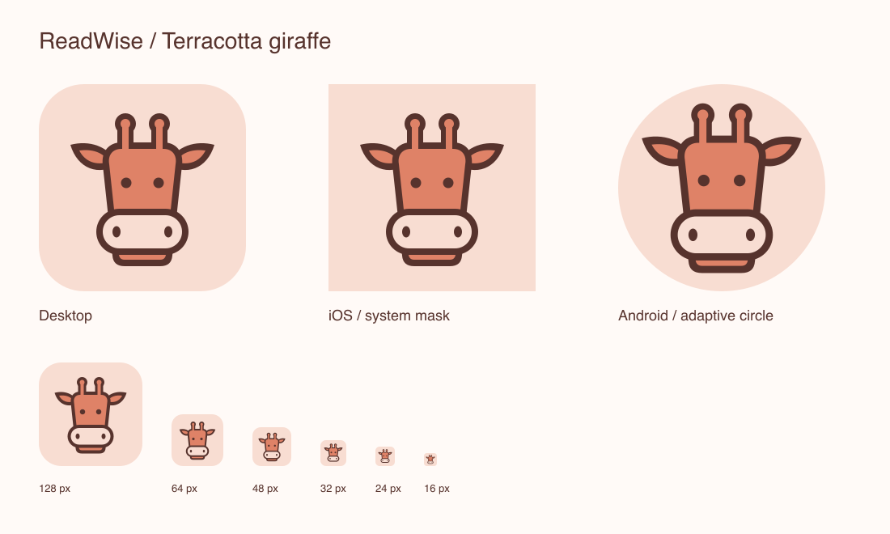

# ReadWise · 陶土蜜桃长颈鹿

用户确认方向：**D · 陶土蜜桃**。正式资源已经替换旧的绿色书本图标；本轮不改变界面主题与功能。



## 精修

- 保留长脸、横耳、短角和宽口鼻部，不增加字母、书本或装饰斑点。
- 将描边改为纯填色轮廓；统一常规版约 8/256 的边缘厚度。
- 连接角尖、角柄和头顶的填色，避免在大尺寸出现深色接缝。
- 修整耳朵内外轮廓，略放大眼睛与鼻孔。
- 16–32px 专用版加粗轮廓与五官、简化鼻孔为圆点、去掉下颌短线，避免直接缩小大图时细节混在一起。

## 颜色

| 角色 | HEX | RGB |
|---|---|---|
| 蜜桃背景 / 口鼻部 | `#F8DDD2` | 248, 221, 210 |
| 陶土主体 | `#DF8267` | 223, 130, 103 |
| 暖棕轮廓 / 五官 | `#57332D` | 87, 51, 45 |

屏幕 RGB 方案，未做印刷打样或指定 Pantone。不要自动用原来的绿色主题替换这些颜色。

## 母版与导出

- `app/resources/icon.svg`：常规母版，256 单位方形画布，满铺背景，纯填色，无字体依赖。
- `app/resources/icon-small.svg`：微型母版，同画布与配色，面向 16/24/32px。
- `scripts/generate_app_icons.py`：唯一正式导出脚本。初轮的 `docs/design/giraffe-icon/generate.py` 只重建历史配色，不应拿来导出正式资源。

| 平台 | 输出与引用 |
|---|---|
| 桌面通用 | `app/resources/icon_{16,32,64,128,256,512,1024}.png`；圆角透明底，根目录 `resources/` 保持相同 PNG |
| Windows | `app/resources/icon.ico`，含 16/24/32/48/64/128/256px；由 cargo-makepad 嵌入可执行文件 |
| macOS | `app/resources/icon.icns`，含 16–1024px 和 Retina 槽位；cargo-makepad 自动复制为 `.app/Contents/Resources/AppIcon.icns` |
| Linux | 打包脚本继续使用 `app/resources/icon_512.png`，无需修改安装器 |
| iOS | `app/packaging/ios/icons/Assets.xcassets/AppIcon.appiconset/`，独立方形、RGB 无 alpha 图片，圆角由系统处理 |
| Android 旧式 | 五组 `mipmap-*/ic_launcher.png` |
| Android 自适应 | `mipmap-anydpi-v26/ic_launcher.xml` 引用蜜桃纯色背景与五密度前景；前景按 108dp 图层的中心 66dp 安全圆缩放 |

Android 实际形状由启动器决定，预览展示圆形遮罩的合成效果，不代表真机截图。iOS 预览刻意展示未加系统圆角的源图。

## 修改与验证

macOS 可通过 `brew install librsvg imagemagick` 安装导出依赖；其他平台安装等效的 `rsvg-convert` 与 ImageMagick 7 `magick` 即可。打包直接使用已提交资源，不需要这些工具。

```bash
python3 scripts/generate_app_icons.py
python3 scripts/generate_app_icons.py --check
python3 -m unittest discover -s scripts -p test_app_icons.py -v
```

`--check` 在内存中重建并比较 45 个文件，不覆盖资源；发现缺失或过期会失败。只改母版而不导出，不能使 PNG/ICO/ICNS 自动更新。

已完成：

- SVG 结构审计，无字体、滤镜、位图或缩放描边。
- 总览与 128/64/48/32/24/16px 渲染目视检查；16px 保留整体轮廓，表情细节不如 32px 清晰，不建议把微型图放大代替常规母版。
- 8 项自动资源回归与 45 项导出物逐字节一致性检查。
- macOS ICNS 由系统 `iconutil` 解析通过；桌面 debug 构建通过，`.app` 中的图标文件与新 ICNS 字节一致，Info.plist 指向 `AppIcon`。
- iOS 图标目录由 Xcode `actool` 编译通过；没有只凭 PNG 存在就认为目录有效。
- Android 图标资源由 `aapt2` 编译并链接最小测试 APK 通过，各密度均解析到新的 adaptive icon。

尚未完成：真机主屏幕检查、Windows/Linux 桌面显示验收、完整移动发行包构建、安装现有发行版后的系统图标缓存刷新。已安装的旧应用不会因仓库图片变化而自动更新，需重新构建并安装。初轮 `audit.txt` 和 `tests.html` 记录的是历史配色，不是这次正式母版的验收报告。

## 使用与限制

- 保留画布内留白，不单独横向或纵向拉伸，不给五官加渐变或阴影。
- 系统图标按各平台输出使用，不把带透明圆角的桌面图送入 iOS 图标目录。
- 这次交付范围是 App 图标替换，不包含新字标、单色品牌系统或完整印刷规范。
- 参考来自用户提供的 `cop.svg`（含 SVG Repo 注释，未标明具体许可证）。本稿重绘了矢量路径，但不构成素材授权或商标无冲突保证；正式发布前仍需核查授权、近似图形及相关商标。
